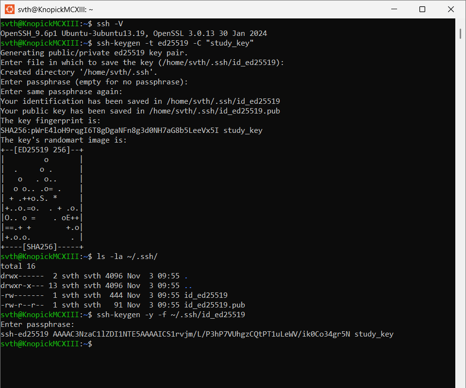
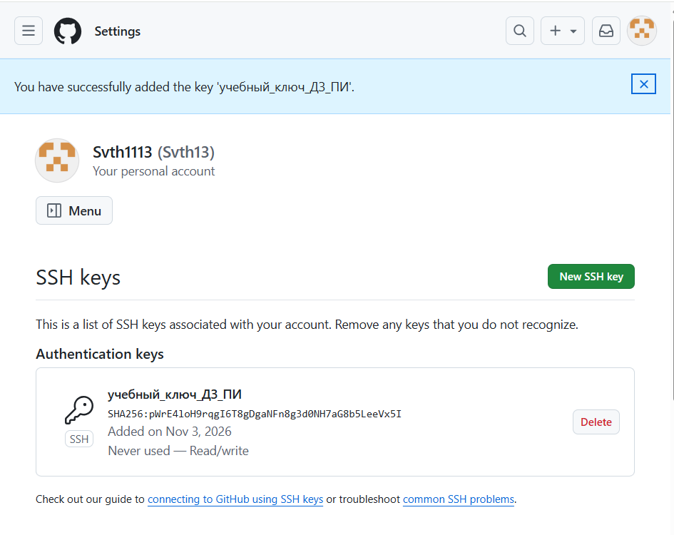
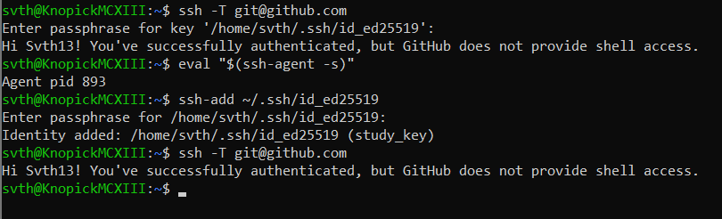
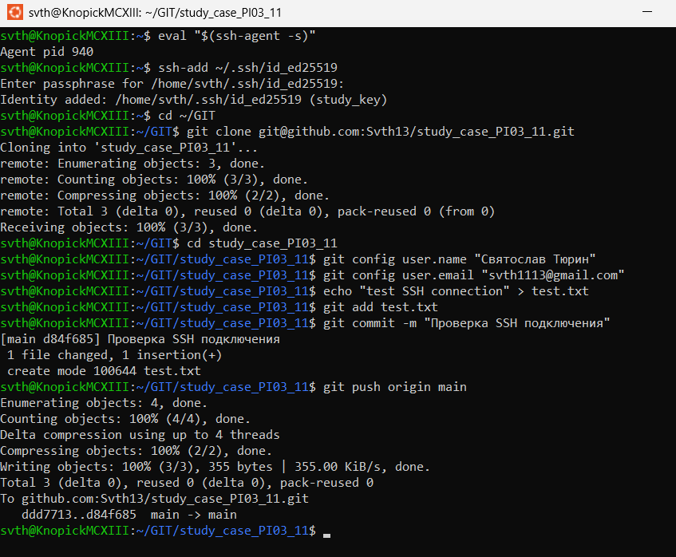

# study_case_PI03_11
## Домашняя работа 2, программная инженерия

Выполнил студент группы РИМ-160921к
Тюрин Святослав Олегович

### Задание 1. Установка SSH-клиента и генерация ключевой пары

Скриншот выполнения: 

**Процесс выполнения:**

Проверка версии SSH-клиента
`ssh -V`

Генерация пары ключей алгоритмом ed25519
`ssh-keygen -t ed25519 -C "study_key"`

Проверка созданных файлов
`ls -la ~/.ssh/`

Проверка защиты приватного ключа
`ssh-keygen -y -f ~/.ssh/id_ed25519`

**Результат выполнения:**

Сгенерирована пара ключей ed25519

Приватный ключ защищён passphrase

Ключи сохранены в ~/.ssh/id_ed25519 и ~/.ssh/id_ed25519.pub

### Задание 2. Добавление публичного ключа в аккаунт GitHub

Скриншот выполнения :

**Процесс выполнения:**

Вывод публичного ключа для копирования
`cat ~/.ssh/id_ed25519.pub`

Скопировано содержимое файла ~/.ssh/id_ed25519.pub
В настройках GitHub (Settings → SSH and GPG keys) добавлен новый SSH-ключ
Название ключа: "учебный_ключ_ДЗ_ПИ"
Получено подтверждение успешного добавления ключа

**Результат выполнения:**

Публичный ключ успешно добавлен в аккаунт GitHub

Ключ отображается в списке Authentication keys

Дата добавления: Nov 3, 2026

Тип ключа: SSH (SHA256 fingerprint)

### Задание 3. Проверка SSH-подключения к GitHub

Скриншот выполнения :

**Процесс выполнения:**

Запуск ssh-agent для удобной работы
`eval "$(ssh-agent -s)"`

Добавление ключа в агент
`ssh-add ~/.ssh/id_ed25519`

Проверка подключения к GitHub
`ssh -T git@github.com`

**Результат выполнения:**

ssh-agent запущен (Agent pid 893)

Ключ успешно добавлен в агент

Подключение к GitHub установлено успешно

Получено приветствие: "Hi Svth13! You've successfully authenticated, but GitHub does not provide shell access."

благодаря ssh-агенту соединение установлено без запроса пароля от GitHub 

### Задание 4. Работа с репозиторием по SSH

Скриншот выполнения :

**Процесс выполнения:**

Клонирование репозитория по SSH
`git clone git@github.com:Svth13/study_case_PI03_11.git`

Переход в директорию репозитория
`cd study_case_PI03_11`

Настройка Git (имя и email)
`git config user.name "Святослав Тюрин"`
`git config user.email "svth1113@gmail.com"`

Создание тестового файла
`echo "test SSH connection" > test.txt`

Добавление файла в индекс
`git add test.txt`

Создание коммита
`git commit -m "Проверка SSH подключения"`

Отправка изменений на GitHub
`git push origin main`

**Результат выполнения:**

Репозиторий успешно склонирован по SSH-URL

Создан тестовый файл test.txt

Создан коммит с сообщением "Проверка SSH подключения"

Изменения успешно отправлены на GitHub

Использован SSH-ключ для аутентификации
